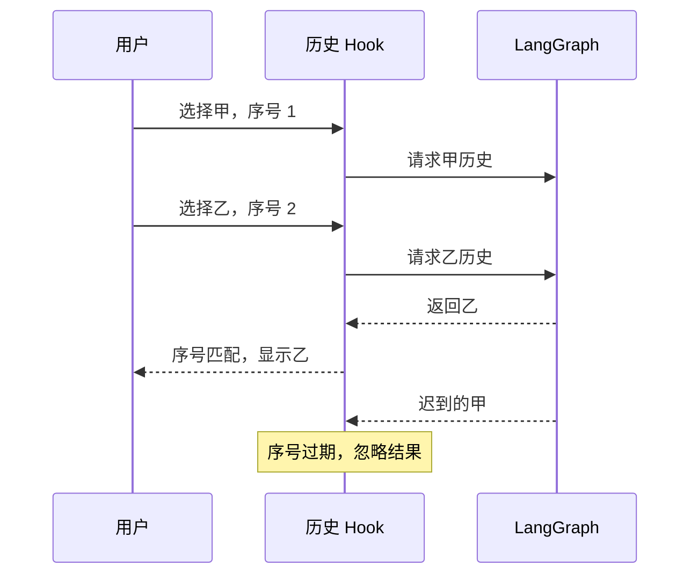

# 开发与学习记录：对话恢复与删除

更新：2026-10-27（2026-10-30 移除旧版麦当劳工作台内容，旧实现见 `archive/mcd-v1` 分支）。

## 本次解决的问题

- 对话列表增加删除按钮与二次确认；删除失败保留原记录，删除当前对话后回到新对话。手机和桌面共用该实现。
- 历史加载增加加载中、失败、重试状态，隔离切换过程中迟到的响应；保留新建对话的流式输出，刷新后可恢复。
- Next.js 从截图中的 16.4.0 更新到 16.4.3，并更新相关依赖及锁文件。开发工具按钮本身是调试入口，不是业务错误，生产构建不显示。

## 对话历史为什么会出现空白

本次确认并修复的是前端失败处理和异步竞态；不能据此断定每一次历史空白都来自同一原因。后端不可达、记录被删除、开发存储丢失，也都可能导致加载失败。

调用入口：

1. `web/src/providers/Stream.tsx` 的 `StreamSession` 根据 URL 的 `threadId` 创建稳定 SDK client，将历史查询交给自定义 hook。
2. `web/src/hooks/use-conversation-history.ts` 的 `mutate` 调用 `client.threads.getHistory(id, {limit: 1})`。最新检查点包含累计 messages，因此只取最新一份，不下载多份重复正文。
3. hook 用 `snapshot` 保存查询所属 ID、数据、错误和加载状态；异常被捕获，界面显示“重新加载对话”，不让被忽略的 Promise 拒绝变成开发报错浮层。
4. 每次查询递增 `generation`，只有序号仍是最新的响应能更新当前状态。返回数据同时检查所属 ID，加载时不显示另一会话的正文。
5. 新建流通过 `onThreadId` 写入 URL 时，检查点可能尚未存在。`createdThread` 标记跳过这次过早读取，等待 SDK 在流结束后刷新；`StreamSession` 的 key 不包含 threadId，避免写 URL 时销毁正在输出的流。



这属于“忽略过期结果”，并不保证取消已经发往服务端的请求。它解决界面一致性问题；如果未来要减少无效网络开销，可以在确认 SDK 支持后再增加 AbortController。

删除入口在 `web/src/components/thread/history/index.tsx`：用户确认后，若删除的是当前对话，先停止流，再调用 `ThreadProvider.deleteThread`。`web/src/providers/Thread.tsx` 等服务端删除成功后才过滤本地列表，并使更早的列表查询失效，防止旧列表把已删除条目重新放回来。删除失败显示提示，不提前移除记录。

删除对话不会清除用户长期偏好。LangGraph 的开发服务存储在 `.langgraph_api`，不要通过删目录排查加载问题。

## 实际验证

前端类型、构建和审计（在 `web` 目录；先停止占用同一 `.next` 的开发服务）：

```powershell
$env:NODE_OPTIONS='--require ./scripts/use-typescript6.cjs'
corepack pnpm exec tsc --noEmit
corepack pnpm build
corepack pnpm audit --registry=https://registry.npmjs.org
```

启动本机前后端后，可在 `web` 运行浏览器回归：

```powershell
node scripts/verify-conversations.mjs
```

脚本使用本机 Edge，创建并清理自己的测试会话，验证历史刷新、503 后重试、迟到响应隔离、删除取消/失败/成功、手机适配及新建流刷新恢复。新建流测试会调用一次配置的真实模型，请留意 API 用量。

## 未完成项

- 前端对话列表最多加载一百条，尚无翻页；LangGraph 开发服务也不是生产持久化部署方案。

## 面试练习

**1. 如何处理快速切换会话产生的竞态？**

一次请求发出不代表其返回时还属于当前页面。历史 hook 为每次请求分配递增序号，只允许最新序号更新状态，并检查 threadId。它不取消服务端任务；错误和加载状态也必须带所属会话，不能只保护正文。

## 自主理解检查

1. 甲对话请求比乙晚返回时，`generation` 和 `snapshot.id` 各自挡住什么问题？只检查其中一个有什么局限？
